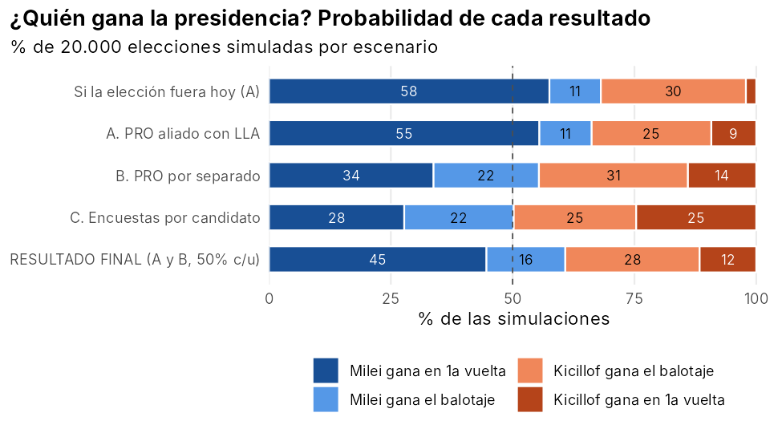
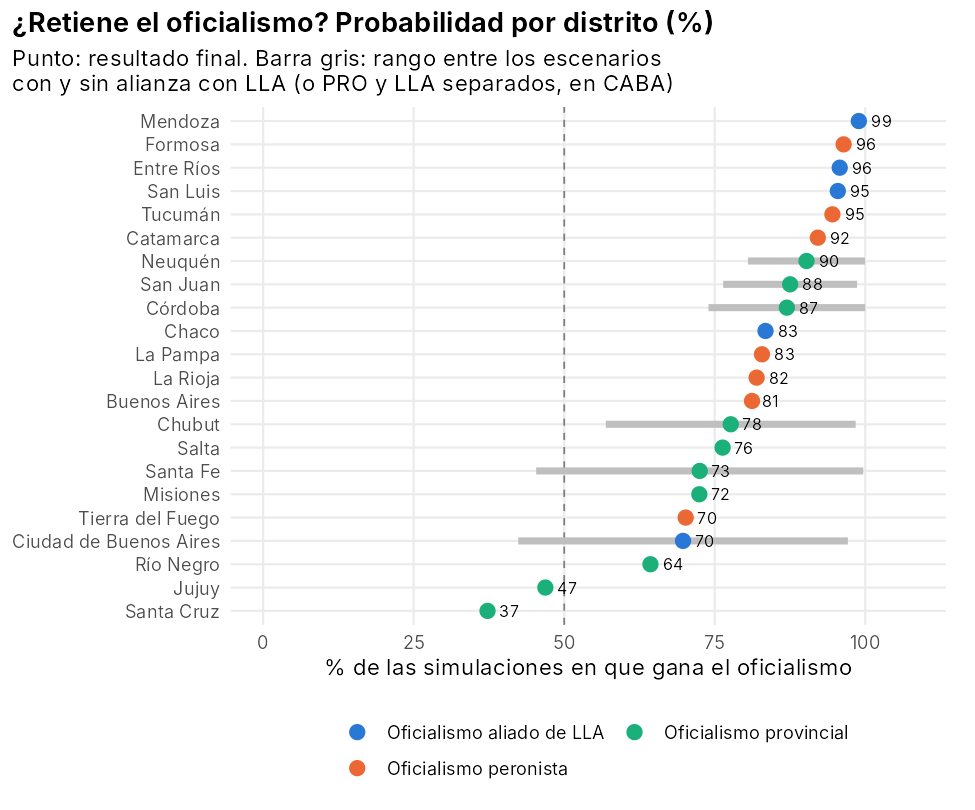
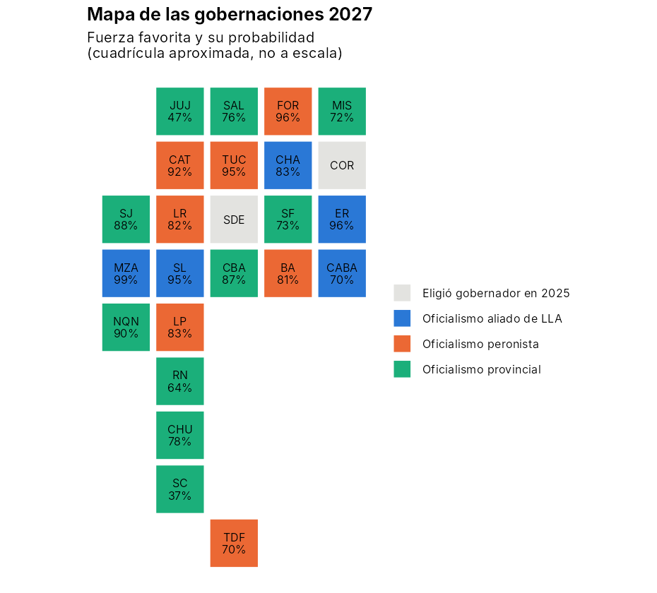

# ¿Quién gobierna desde 2027? Simulación de las elecciones argentinas

Simulación Monte Carlo de la elección **presidencial** (primera vuelta y balotaje) y de las **22 gobernaciones** que se eligen en 2027 (21 provincias + Ciudad Autónoma de Buenos Aires; Corrientes y Santiago del Estero ya eligieron en 2025). Se usan **solo datos públicos, cada uno con su fuente**: encuestas de 2026, resultados oficiales 2023–2025 y el error histórico de las encuestas argentinas.

> ⚠️ Es una **simulación probabilística** con los datos disponibles al 19/11/2026. **No es una predicción** ni toma partido por ningún espacio.

📄 **Informe completo (PDF, formato arXiv):** [`report/informe.pdf`](report/informe.pdf)

---

## Resultado final

| Presidencia 2027–2031 | Probabilidad |
|---|---|
| **Javier Milei (LLA) reelecto** | **60,8%** (44,6% en primera vuelta + 16,2% en balotaje) |
| **Axel Kicillof (Fuerza Patria)** | **39,2%** (11,6% en primera vuelta + 27,6% en balotaje) |
| Hay balotaje | 43,8% |
| Milei gana el balotaje, *si lo hay* | 35,9% |

- Las encuestas de balotaje dan un **empate** (49,9% Milei / 50,1% Kicillof). La ventaja de Milei en el resultado final viene de que **puede ganar en primera vuelta**. Si no lo logra, suele ser porque le fue peor que lo que decían las encuestas, y entonces llega en desventaja al balotaje.
- El resultado depende mucho de dos cosas: **la alianza LLA–PRO** (Milei 66,2% si van aliados, 55,4% si van separados) y **qué encuestas se miran** (con las que preguntan por candidatos, la elección queda 50,2% a 49,8%).
- **Gobernaciones:** el oficialismo es favorito en los 22 distritos, pero se esperan en promedio 4,5 cambios de signo. Los distritos más abiertos son Santa Cruz, Jujuy y Río Negro. En la mediana, LLA (sola o aliada con el oficialismo provincial) gana 10 gobernaciones, el peronismo 7 y los provincialismos 5.




<p align="center"></p>

---

## Cómo funciona

1. **Promedio de encuestas** ponderado por tamaño de muestra (√n, tope 3.000) y antigüedad (vida media de 45 días).
2. **Votos afirmativos y reglas de la Constitución** (arts. 97 y 98): se gana en primera vuelta con más del 45%, o con 40% y más de 10 puntos de diferencia.
3. **Incertidumbre calibrada con datos argentinos**: error histórico de las encuestas en 2023–2025 (RMSE del margen de 8,5 pp), más un supuesto explícito de cambio de opinión hasta octubre de 2027 (5 pp, con sensibilidad de 0 a 7).
4. **20.000 elecciones simuladas** por escenario, con un shock común a la primera vuelta y al balotaje.
5. **Gobernaciones**: se parte del resultado real de Diputados 2025 en cada distrito y se aplican el cambio nacional (común a todas las provincias), el **efecto oficialismo** medido con 7 elecciones provinciales de 2025 (+11,4 pp en promedio), ruido propio de cada distrito y las encuestas provinciales.

## Cómo correrlo

1. Abrir `Elecciones2027.Rproj` en RStudio.
2. Abrir `main.R` y apretar **Source**. Tarda menos de un minuto.

Solo usa **R base + ggplot2** (se instala solo si falta). La semilla está fija, así que los resultados son idénticos en cualquier computadora. Para regenerar el PDF hay que compilar `report/informe.tex` con pdfLaTeX + BibTeX.

## Estructura

```
├── main.R                         # punto de entrada
├── R/
│   ├── utils.R                    # funciones con pre/postcondiciones
│   ├── 01_datos.R                 # carga y valida los datasets
│   ├── 02_agregador.R             # promedio de encuestas y error histórico
│   ├── 03_simulacion_presidencial.R
│   ├── 04_simulacion_provincial.R
│   └── 05_resultados.R            # gráficos, tablas y cifras del informe
├── data/                          # 8 CSV con 123 filas, cada una con su fuente
├── figures/                       # gráficos (PDF y PNG)
├── results/                       # tablas LaTeX, CSV de resultados y numeros.tex
└── report/                        # informe LaTeX (template arXiv) y PDF
```

## Datos

Cada CSV de `data/` tiene una columna `fuente` con el enlace de origen: encuestas publicadas (Perfil, iProfesional/Clarín, Letra P, El Cronista, Contexto Tucumán, entre otros), resultados oficiales de 2025 (C5N, Chequeado, La Nación, Todo Jujuy) y el estado de cada candidatura. Cuando un candidato no está definido, figura como "a definir".

## Limitaciones

Hay pocas encuestas y la elección está lejos. Kicillof no es candidato oficial. El error de las encuestas se calibra con 4 elecciones y el efecto oficialismo con 7. No se modelan las reglas electorales propias de cada provincia ni las disputas judiciales por reelecciones. Más detalles en la sección *Conclusiones* del informe.

---

**Autor:** Matías Costabile — Licenciatura en Ciencia de Datos, Pontificia Universidad Católica Argentina (UCA).
